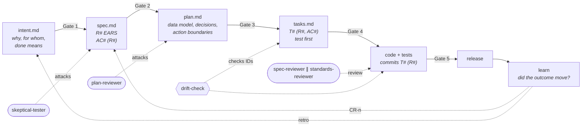
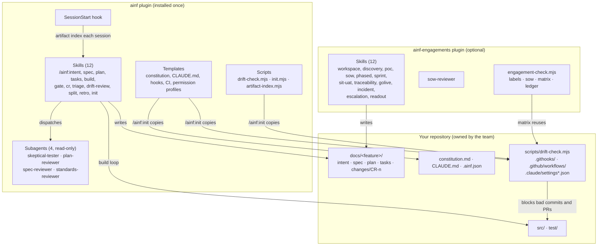
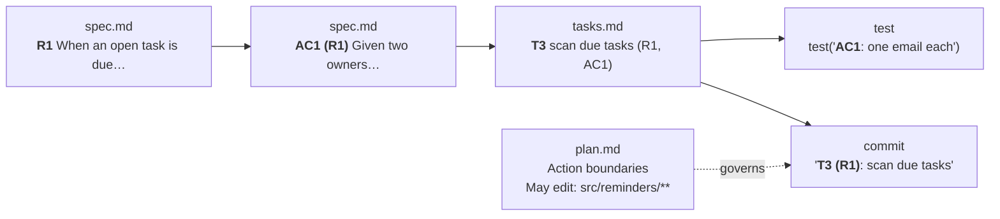
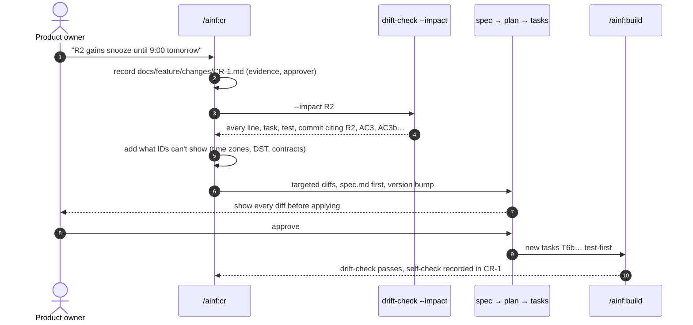

# AI-Native Framework

**Claude Code plugins for *The Architect's AI-Native SDLC*.** Humans own intent and judgment, agents do the typing, and the files keep the two honest.

```
intent.md → spec.md → plan.md → tasks.md → code + tests → release → learn
   G1          G2        G3         G4          G5
```

Two plugins in one marketplace:

| Plugin | For | Version |
|---|---|---|
| [`ainf`](plugins/ainf) | The core chain on any codebase you control: artifacts, five human gates, requirement-ID traceability, drift checks, change requests, reviews and retros. | 0.6.0 |
| [`ainf-engagements`](plugins/ainf-engagements) | The same chain in consulting: an engagement workspace of ID'd ledgers, discovery → POC → SOW, phased delivery with sprints, SIT, UAT and go-live, read-only incident response and red-account escalations, and readouts generated from the ledgers. Requires `ainf`. | 0.6.0 |

---

## Contents

- [Why this exists](#why-this-exists)
- [Principles](#principles)
- [Installation](#installation)
- [Quick start](#quick-start)
- [Reference docs](#reference-docs)
- [Architecture](#architecture)
- [Skill catalog: `ainf`](#skill-catalog-ainf)
- [Skill catalog: `ainf-engagements`](#skill-catalog-ainf-engagements)
- [Reviewer subagents](#reviewer-subagents)
- [Scripts, hooks and checks](#scripts-hooks-and-checks)
- [What `/ainf:init` puts in your repo](#what-ainfinit-puts-in-your-repo)
- [Conventions](#conventions)
- [Configuration](#configuration)
- [Repository layout](#repository-layout)
- [Context cost](#context-cost)
- [Design decisions](#design-decisions)
- [Version log](#version-log)
- [Roadmap](#roadmap)
- [Known limitations](#known-limitations)
- [Development](#development)
- [Credits and license](#credits-and-license)

---

## Why this exists

Coding agents type faster than any team can review. That moves the bottleneck from writing code to deciding what to build and checking that it was built. Most teams don't move their process along with it:

- **Intent lives in chat.** The agent builds from a conversation nobody can review, version or hand to the next person. When the session ends, the reasoning is gone.
- **Plausible beats correct.** An agent's plan reads well line by line. A plan that breaks the spec in line 14 still sounds right, and nobody compares it with the spec.
- **Defects are caught late.** A requirement missed in the intent is cheap to fix in review and expensive to fix in UAT. Agents make the late stages faster, so the early stages matter more, not less.
- **Guidance is mistaken for enforcement.** Writing "never touch migrations" in a prompt shapes what the agent *tries*. It doesn't decide what can *land*.
- **Specs drift silently.** By sprint 4 the signed spec describes a system that no longer exists, and nobody notices until a client does.
- **"AI-native" becomes waterfall in markdown.** Running every gate on every change is just as broken as running none.

This framework is the operational form of the course. Its skills write the artifacts, scripts check the thread between them, hooks and permissions enforce the boundaries, and reviewer subagents attack each layer before a person approves it. Everything is plain markdown in your repository: reviewable in a pull request, diffable, and owned by you.

**Inspired by:** Anthropic Academy's Claude Code courses, practice from consulting delivery, and Matt Pocock's skills (grill-me, to-spec, to-tickets, tdd, code-review). This is an independent implementation, not a fork of any of them.

## Principles

1. **Files are the source of truth.** Chat history isn't an artifact. Every decision that matters lands in a file a person can review.
2. **A person approves every gate.** Agents check, raise and draft; they never set `Status: APPROVED`. Only a named human does.
3. **One ID thread.** `R1 → AC1 (R1) → T3 (R1, AC1) → test('AC1: …') → commit "T3 (R1): …"`. If a link is missing, `drift-check` says so.
4. **Fix the earliest artifact.** When code and spec disagree, find the first artifact that let the problem in and change that first.
5. **Guidance is not enforcement.** `CLAUDE.md` shapes behaviour; permissions, git hooks and CI decide what can land. The plugin ships both.
6. **Proportionate rigour.** `/ainf:triage` decides how much ceremony a change earns. A copy fix doesn't need five gates.
7. **Provenance ranks evidence.** A signed spec, the live system or a reviewed document can block. What someone said, or what an agent generated, becomes an open question with an owner.

---

## Installation

### Prerequisites

- [Claude Code](https://docs.claude.com/en/docs/claude-code) (CLI, desktop or IDE extension).
- **Node.js 20+** and **git** in the repository where you'll use it. The scripts have no dependencies.
- Access to GitHub. The repository is public.

### Install from the marketplace

```bash
claude plugin marketplace add venkatviswa/ai-native-framework
```

```bash
claude plugin install ainf@ai-native-framework
```

For consulting work, also install the engagements plugin:

```bash
claude plugin install ainf-engagements@ai-native-framework
```

Or install from inside a Claude Code session with `/plugin`, then browse the `ai-native-framework` marketplace.

### Set up a repository

In the repository you want to work in, start Claude Code and run:

```
/ainf:init
```

It writes the scaffold without overwriting anything, sets `git config core.hooksPath .githooks`, then tailors the files to your stack: test command, code directories and permission paths. Commit the scaffold, then make the `drift-check` workflow a required check in branch protection.

### Update and remove

```bash
claude plugin marketplace update ai-native-framework
```

```bash
claude plugin uninstall ainf-engagements@ai-native-framework
```

Plugin updates don't touch files that `/ainf:init` already copied into your repo. That includes `scripts/drift-check.mjs`, so the team stays on the version it reviewed. To upgrade it, re-copy it deliberately and review the diff.

### Run from a local clone (development)

```bash
git clone https://github.com/venkatviswa/ai-native-framework
```

```bash
claude --plugin-dir ai-native-framework/plugins/ainf --plugin-dir ai-native-framework/plugins/ainf-engagements
```

---

## Quick start

A feature from idea to merged code, with the reminders example from the course:

```
/ainf:triage   "add due-date reminders to the task tracker"     → Tier 2: intent, spec, plan, tasks; Gates 1–5
/ainf:intent                                                     → interview (≤ 8 questions) → docs/reminders/intent.md
/ainf:gate 1 docs/reminders                                      → PASS/FAIL per item; you approve
/ainf:spec                                                       → EARS R1..Rn, AC1 (R1).., then skeptical-tester attacks it
/ainf:gate 2 docs/reminders
/ainf:plan                                                       → data model, decisions, action boundaries, traceability
/ainf:gate 3 docs/reminders                                      → plan-reviewer runs first
/ainf:tasks                                                      → T1..Tn, each citing R/AC, test first
/ainf:gate 4 docs/reminders                                      → includes drift-check output
/ainf:build T1                                                   → failing test → code → commit "T1 (R1): …"
/ainf:drift-review docs/reminders                                → does the code do what the files say?
/ainf:gate 5 docs/reminders                                      → spec-reviewer + standards-reviewer in parallel
```

When the requirement changes after release:

```
/ainf:cr  "R2: add snooze until 9:00 tomorrow in the owner's time zone"
          → CR-1.md, drift-check --impact R2, spec diff first, then plan, tasks, tests
```

The artifact skills also trigger on their own when the conversation calls for them. Saying "I want to add due-date reminders…" starts the intent interview.

---

## Reference docs

Longer explanations live in [`docs/`](docs/README.md), one page per idea, so this README can stay an overview.

- [**Concepts: IDs, drift and drift-check**](docs/concepts.md): why every artifact has stable IDs, the two kinds of drift, every drift-check mode and how to fix what it reports, guidance vs enforcement.
- **Artifact guides.** Each covers what the file is for, who owns it, every section, and weak vs strong examples:
  [constitution.md](docs/artifacts/constitution.md) · [CLAUDE.md](docs/artifacts/claude-md.md) · [intent.md](docs/artifacts/intent.md) · [spec.md](docs/artifacts/spec.md) · [plan.md](docs/artifacts/plan.md) · [tasks.md](docs/artifacts/tasks.md) · [stories.md](docs/artifacts/stories.md) · [CR-n.md](docs/artifacts/change-request.md)
- [**Engagements: the workspace and the ledger check**](docs/engagements.md): why engagement documents drift, the F-/D-/A-/Q-/RISK-/GAP- ledgers, the rules that keep them honest, and how discovery, escalation and readouts use them.
- [**Mappings**](docs/mappings/README.md): how the chain fits SAFe, Shape Up and Team Topologies.
- **Placeholder templates** for each artifact are in [`plugins/ainf/templates/`](plugins/ainf/templates/). `/ainf:init` copies them into your repo, and the skills fill them in. See [How the templates reach your project](docs/README.md#how-the-templates-reach-your-project).

---

## Architecture

### The artifact chain and its gates

Each layer is derived from the one before it and reviewed by a person before the next one starts. Reviewer subagents attack a layer before its gate, and scripts check the ID thread between layers.



### How the plugin is built

Skills are the instructions, subagents are isolated read-only reviewers, and scripts do the deterministic checking. The hook and the templates connect the plugin to your repo.



### Guidance compared with enforcement

Claude Code's documentation says it plainly: permission rules are enforced by Claude Code, not by the model. `CLAUDE.md` shapes what the agent tries. The framework puts each rule in the cheapest layer that can actually enforce it.

```mermaid
flowchart LR
    A["CLAUDE.md<br/>constitution.md"] -->|shapes what the agent tries| B[".claude/settings*.json<br/>permissions per step"]
    B -->|decides what the agent can do| C[".githooks<br/>pre-commit · commit-msg"]
    C -->|decides what can be committed| D["CI drift-check<br/>required check"]
    D -->|decides what can merge| E["branch protection<br/>human review"]

    style A fill:#fff4d6,stroke:#c9a227
    style B fill:#e6f2ff,stroke:#3b82f6
    style C fill:#e6f2ff,stroke:#3b82f6
    style D fill:#e6f2ff,stroke:#3b82f6
    style E fill:#e8f7ec,stroke:#22a55b
```



| Layer | Example rule | Enforced by |
|---|---|---|
| Guidance | "If code and spec disagree, stop and ask" | the model (best effort) |
| Permissions | the agent may edit `src/**`, must ask for `plan.md`, can never `git push` | Claude Code |
| Pre-commit | tests pass; code changes stay inside plan.md's action boundaries; no stale IDs | git hook → `drift-check --run-tests` |
| Commit message | code commits name `T# (R#)` | git hook → `drift-check --commit-msg` |
| CI | dev mode on every pull request; complete mode on `release/**` | GitHub Actions |
| Review | a person approves each gate and each production change | branch protection, the gate skill |

### The ID thread

`drift-check` follows one thread from requirement to commit. A broken link fails the hook or the CI check.



| Check | Dev mode (pre-commit, PR) | Complete mode (release) |
|---|---|---|
| plan/tasks cite only IDs defined in spec | ✔ | ✔ |
| every AC maps to a real R | ✔ | ✔ |
| every task names a requirement; every requirement has a task | ✔ | ✔ |
| tests cite only defined IDs | ✔ | ✔ |
| changed code and tests inside `May edit:`; `Ask first:` needs `AINF_APPROVED` | ✔ | ✔ |
| every criterion has a test | note | **✔ fails** |
| every requirement has a test, directly or through its criteria | — | **✔ fails** |

### A change request



### Three engagement shapes

The artifacts stay the same across engagements. What changes is what each one contains, how heavy the gates are, and where the risk sits. Under every shape sits the same workspace: facts, decisions, actions, questions, risks and gaps, each written once with an ID, plus a status snapshot and a journal ([docs/engagements.md](docs/engagements.md)).

```mermaid
flowchart TB
    subgraph D["Discovery (pre-SOW)"]
        direction LR
        d1["notes/ + facts.md<br/><i>what was said, written once</i>"] --> d2["intent.md (hypothesis)<br/><i>every line labelled + sourced</i>"]
        d2 --> d3["poc-spec + poc-plan<br/><i>one claim that can fail</i>"]
        d3 --> d4["poc-result.md"] --> d5["sow.md<br/><i>every item cites R#</i>"]
    end
    subgraph PH["Phased delivery"]
        direction LR
        p1["Design weeks<br/>intent · spec · plan<br/><b>signed baseline</b>"] --> p2["Sprints 1..n<br/>tasks-sprint-N.md<br/>close = drift diff"]
        p2 --> p3["SIT<br/>sit.md SIT-n (R#)"] --> p4["UAT<br/>uat.md UAT-n (R#)"]
        p4 --> p5["traceability.md"] --> p6["cutover.md<br/>go / no-go"]
        p2 -. "spec change" .-> cr["/ainf:cr"]
    end
    subgraph IN["Incident → escalation"]
        direction LR
        i1["incident.md<br/>restore first"] --> i2["observed vs expected<br/>timeline"] --> i3["≤ 5 ranked hypotheses<br/>cheapest check each"]
        i3 --> i4["evidence log<br/>read-only agent"] --> i5["named human<br/>approves prod changes"] --> i6["fix reproduced first<br/>spec + test updated"]
        i6 -. "recurring / still red" .-> e1["escalation<br/>verify → RCA → contain, cure → exit"]
    end
```



| | Discovery | Phased delivery | Incident |
|---|---|---|---|
| intent.md | hypothesis, sources, what we must learn | committed outcomes, signed off | restore, then root cause, then trust |
| spec.md | POC claim and first-cut requirements | numbered baseline under change control | observed vs expected, reproduction |
| plan.md | POC plan, risks, estimate basis | architecture, environments, migration, cutover | ranked hypotheses, action boundaries |
| Gates | client sponsor review | formal signoffs, change requests | reads authorized and bounded; a named human on production changes |
| Biggest risk | committing before the unknowns are known | late discovery in UAT, spec drift | guessing, and unreviewed writes to production |
| Deliverable | POC result and SOW | traceable, tested release | fix, evidence log, updated artifacts |

---

## Skill catalog: `ainf`

Invoke a skill as `/ainf:<name>`. Every skill except `init` also triggers automatically when the conversation matches its description.

### The chain

| Skill | What it does | Writes | Gate / checks |
|---|---|---|---|
| `/ainf:init` | Scaffolds the repo: constitution, CLAUDE.md, drift-check, git hooks, CI and permission profiles. Never overwrites. Manual only. | the files listed [below](#what-ainfinit-puts-in-your-repo) | sets `core.hooksPath` |
| `/ainf:intent` | Interviews you (≤ 8 questions, one at a time), never proposes a design, then writes the outcome layer. A **discovery variant** labels every line. | `docs/<f>/intent.md` | Gate 1 |
| `/ainf:spec` | Writes numbered EARS requirements and Given/When/Then criteria, including failure cases, then runs the attack pass with `skeptical-tester`. | `docs/<f>/spec.md` | Gate 2 |
| `/ainf:plan` | Constitution check, data model, contracts, decisions with rejected options, risks, action boundaries, release and rollback, and a traceability table. Review mode dispatches `plan-reviewer`. | `docs/<f>/plan.md` | Gate 3 |
| `/ainf:tasks` | Cuts the plan into small, ordered, test-first tasks citing R/AC, with `(approval)` and `P` markers, and checks coverage. | `docs/<f>/tasks.md` | Gate 4 |
| `/ainf:stories` | Maps backlog stories (Jira, Azure Boards, GitHub issues) to R and AC IDs, one line per story, then reports each story's requirements, criteria tested, tasks and commits. | `docs/<f>/stories.md` | `drift-check --stories` |
| `/ainf:build` | Explore → plan → code → commit, one task at a time. Failing test first, named after its criterion; one commit per task. | code, tests, commits | drift-check |
| `/ainf:gate <1-5> <dir>` | Runs a gate checklist with PASS/FAIL/UNSURE and evidence. Applies the provenance rule. Never approves on its own. | Status line, only on your explicit approval | the gate itself |

### Change, review and learning

| Skill | What it does | Writes |
|---|---|---|
| `/ainf:triage` | Rates a change on three dials (blast radius, data and money sensitivity, reversibility), then names its tier, artifacts, gates, approvers and evidence. | the recommendation; no file |
| `/ainf:cr` | Change request: records CR-n with its evidence and approver, runs `drift-check --impact`, adds the risks IDs can't show, proposes targeted diffs spec-first, shows each diff before applying, then builds test-first. | `docs/<f>/changes/CR-n.md`, targeted edits |
| `/ainf:drift-review <dir>` | Convergence review: does the code do what the artifacts *mean*, not only what the IDs say? Read-only on code. Findings graded by severity, with fix tasks appended until it reports **Converged**. | `## Convergence` in tasks.md |
| `/ainf:split` | Divides one spec across several developers and their agents: one owner per item, shared contracts nobody may change alone, scoped agent instructions, and the integration tests nobody owns yet. | `docs/<f>/split.md` |
| `/ainf:retro` | When an outcome misses or a defect escapes: separates evidence from hypotheses, classifies the cause (intent, spec, boundary, test, review, context or process gap) and names the artifact to fix first. | `docs/<f>/retro-<date>.md` |

## Skill catalog: `ainf-engagements`

Invoke a skill as `/ainf-engagements:<name>`. The worked platform is Salesforce (Service Cloud, Flow, Apex, sandboxes). Each skill notes the cloud-native equivalent (Kafka, Postgres, Kubernetes), and [`references/platforms.md`](plugins/ainf-engagements/references/platforms.md) compares the two.

### Workspace and readouts

| Skill | What it does | Writes | Checked by |
|---|---|---|---|
| `/ainf-engagements:workspace` | Stamps the engagement workspace: one ledger per kind of thing (facts `F-`, decisions `D-`, actions `A-`, questions `Q-`, risks `RISK-`, gaps `GAP-`, systems `SYS-`/`INT-`), a status snapshot, a prepend-only journal, session notes and workspace rules. Runs the after-session loop. | `docs/<engagement>/*.md` | `engagement-check ledger` |
| `/ainf-engagements:readout` | Drafts a client readout or steering update from the ledgers: bottom line first, takeaway titles, every claim citing its ID, inferred items worded as approximate, dates only from actions and decisions. Never sends. | `readout-<date>.md` | `engagement-check ledger` |

### Discovery → POC → SOW

| Skill | What it does | Writes | Mechanical check |
|---|---|---|---|
| `/ainf-engagements:discovery` | Confirms client-data handling first. Session notes are keyed to question IDs with a carry-forward list, facts go to facts.md once, and the **hypothesis** intent labels every line `[fact · F-n]`, `[inference · basis]`, `[recommendation · ours]` or `[open question · Q-n]`. Adds a hypothesis table with dated status, risks vs gaps vs decisions, and SOW entry criteria. | `notes/`, ledgers, `intent.md` | `engagement-check labels`, `ledger` |
| `/ainf-engagements:poc` | Writes **one** falsifiable claim with pass, fail and inconclusive criteria agreed in advance, a 5-day timebox, sandbox-only boundaries, a test table, a stop-and-ask list and a "will NOT build" list, then records the verdict against those criteria with E- evidence. | `poc-spec.md`, `poc-plan.md`, `poc-result.md` | IDs via drift-check |
| `/ainf-engagements:sow` | Derives the SOW's traceable core. Objectives come from confirmed facts, scope from boundaries and the POC result, and assumptions from what the POC didn't retire. Acceptance cites R#. "To confirm" items are never priced. Then dispatches `sow-reviewer`. | `sow.md` | `engagement-check sow` |

### Phased delivery

| Skill | What it does | Writes | Mechanical check |
|---|---|---|---|
| `/ainf-engagements:phased` | Maps design, sprints, SIT, UAT and go-live onto the chain; puts environments, migration and platform limits into plan.md as constraints; records the **signed baseline** with file versions and tag; sends every later spec change through `/ainf:cr`. | `delivery.md` | change-control checklist |
| `/ainf-engagements:sprint` | **Cut:** writes one sprint's tasks, each with its Apex, Flow or unit test stated first, the files or objects it may touch, `P` markers and nothing from other sprints. **Close:** diffs what was built against spec and plan, then fixes the code or updates an artifact. | `tasks-sprint-N.md` | drift-check (reads `tasks-*.md`) |
| `/ainf-engagements:sit-uat` | SIT cases come from plan contracts and failure paths. UAT scenarios come from acceptance criteria, in business language. Both cite the same IDs, plus inspection items. Never invents requirements. | `sit.md`, `uat.md`, `inspection.md` | IDs via matrix |
| `/ainf-engagements:traceability` | Builds a matrix of each requirement against its unit tests, SIT cases, UAT scenarios and inspections, then a fit review, because code coverage is not requirement coverage. | `traceability.md` | `engagement-check matrix` |
| `/ainf-engagements:golive` | Drafts a cutover runbook from plan.md: owners, timings, rollback trigger, point of no return and hypercare. Gives a go/no-go recommendation with evidence. **Never deploys.** | `cutover.md` | `drift-check --complete` |

### Incident and escalation

| Skill | What it does | Writes |
|---|---|---|
| `/ainf-engagements:incident` | For an acute outage. Locks the session down with the read-only incident profile, then keeps one living document. The agent may only read and reproduce; every production-changing action is listed as needing human approval. Fixes are reproduced first and deployed by a human. Customer updates are drafted, never sent. Hands off to escalation when the problem recurs. | `docs/incident-<date>-<slug>/incident.md`, `.claude/settings.incident.json` |
| `/ainf-engagements:escalation` | For a red account or a chronic problem over weeks, on the workspace. Mission intent with three-tier done (containment shipped, cure held, exit on agreed metrics); identities and topology verified before any analysis; related incidents and a sceptical read of any third-party RCA; hypotheses with confirm and kill tests and decision gates; an RCA with a cause tree; remediation with containment apart from cure and capability tags; monitoring, an exit scorecard and a handover. Read-only throughout. | `intent.md`, `rca-plan.md`, `rca.md`, `remediation.md`, `exit.md` |

The document's sections:
- Restore first.
- Observed vs expected, with a timeline of changes.
- Up to 5 ranked hypotheses, each with its cheapest check.
- An evidence log.

---

## Reviewer subagents

All reviewers are read-only. They **raise** findings with evidence and severity; a person decides. Each runs in its own context window, so it judges the artifact against its source and not against the conversation that produced it.

| Agent | Plugin | Runs at | Looks for | Tools |
|---|---|---|---|---|
| `skeptical-tester` | ainf | before Gate 2 | vague words, undefined terms, requirements with no criterion, uncovered cases (time zones and DST, duplicates, concurrency, restarts) | Read, Grep, Glob |
| `plan-reviewer` | ainf | before Gate 3 | plausible plan lines that break a requirement or constitution rule, a data model that can't enforce the spec, vague boundaries | Read, Grep, Glob |
| `spec-reviewer` | ainf | Gate 5, in parallel | criteria with no test or a test that proves too little, behaviour that contradicts the spec, changes outside boundaries | Read, Grep, Glob, Bash (git, drift-check) |
| `standards-reviewer` | ainf | Gate 5, in parallel | bugs, security, secrets, personal data in logs, new dependencies, unnecessary complexity | Read, Grep, Glob, Bash (git) |
| `sow-reviewer` | engagements | after an SOW draft | promises the artifacts don't support, unpriced or hidden assumptions, estimates resting on open questions, unobservable acceptance | Read, Grep, Glob |

---

## Scripts, hooks and checks

### `drift-check.mjs` (copied into your repo by `/ainf:init`)

Checks references, not meaning. A person still reviews whether a test proves its criterion; `/ainf:drift-review` helps with that.

| Command | Where it runs | What it does |
|---|---|---|
| `node scripts/drift-check.mjs` | pre-commit | dev mode on staged files: stale IDs, unlinked tasks, uncovered requirements, action boundaries |
| `… --run-tests` | pre-commit | runs `testCommand` from `.ainf.json` first; a failing test blocks the commit |
| `… --commit-msg <file>` | commit-msg hook | code commits must name `T# (R#)` |
| `… --base origin/main` | CI on pull requests | dev mode on files changed since the base |
| `… --complete` | CI on `release/**`; before "done" | every requirement and criterion has a test |
| `… --feature docs/<f>` | anywhere | limits the check to one feature |
| `… --impact R2[,AC7]` | `/ainf:cr` | every line, task, test, code comment and commit citing those IDs; a requirement brings its criteria. Takes full IDs (`REM-R2`), or short ones with `--feature`. |
| `… --stories [--csv]` | `/ainf:stories`, sprint review | one row per backlog story in `stories.md`: requirements, criteria tested, tasks, commits naming the key. Fails on a story with no ID, a duplicate key or a requirement no story covers. |

`AINF_APPROVED=src/store.js git commit …` records a person's approval for a file under `Ask first:`.

### `engagement-check.mjs` (run from the plugin by the engagement skills)

| Command | Checks |
|---|---|
| `labels <intent.md>` | every bullet carries a label **and** a source; constraints are marked Known, Assumed or Unknown |
| `sow <sow.md> --spec <spec.md>` | Scope and Acceptance items cite requirements defined in the spec; nothing "to confirm" carries an estimate; Scope, Out of scope and Assumptions sections exist |
| `matrix <feature-dir> [--write]` | joins requirements to unit tests, `SIT-n`, `UAT-n` and `INS-n` by ID; flags requirements with no verification, cases citing no or unknown IDs, and tests citing nothing. It reuses your repo's `scripts/drift-check.mjs`, so both see tests the same way. |
| `ledger <engagement-dir>` | every workspace ID (`F-`, `H-`, `E-`, `D-`, `A-`, `Q-`, `RISK-`, `GAP-`, `SYS-`, `INT-`, `INC-`) is defined once and cited only where it exists and is current, readouts included; actions have an owner and a real date; accepted decisions have an approver and a reversal condition; facts have a label and a source; status.md is not behind the journal. See [docs/engagements.md](docs/engagements.md). |

### SessionStart hook

`artifact-index.mjs` prints a short index at the start of each session. It gives each feature's artifact status, its BLOCKING question count and task progress (across sprint files), and it includes engagement artifacts. The agent starts from the files, not from memory. It prints nothing in repos without a `docs/` folder.

```
AI-native SDLC artifacts in this repo (files are the source of truth; read them before editing):
- docs/reminders [REM]: intent APPROVED v1.0 · spec APPROVED v1.1 · plan APPROVED v1.0 · tasks 6/9
- docs/northfield: intent DRAFT (hypothesis) (2 BLOCKING) · poc-spec DRAFT · sow DRAFT
- docs/incident-2026-10-09-case-locks: incident OPEN
- docs/escalation-batch-timeouts: workspace status 2026-10-12 · intent DRAFT · rca DRAFT · remediation DRAFT
```

---

## What `/ainf:init` puts in your repo

| File | Job |
|---|---|
| `constitution.md` | Project principles and the approver per gate. Every plan runs a constitution check against them. Five starter rules plus `[placeholders]` for yours. |
| `CLAUDE.md` | Operating instructions the agent reads every session: Project, Stack and commands, Where things live, Read first, Things the agent gets wrong (the second-time rule), Always, Never, Enforced elsewhere. Init fills the stack placeholders from your repo. |
| `REVIEW.md` | The review standard: three passes (bugs, security, compliance), severity meaning, at most five nits, and the two questions a human answers. `/ainf:gate 5` reports against it. |
| `.github/PULL_REQUEST_TEMPLATE.md` | A change request mapped to the chain: tasks, requirement and criterion IDs, files inside the boundaries, evidence pasted before review, the REVIEW.md passes. |
| `.ainf.json` | Where features, code and tests live, and the test command. |
| `scripts/drift-check.mjs` | The checker, a copy owned by the team. |
| `.githooks/pre-commit` | `drift-check --run-tests` |
| `.githooks/commit-msg` | `drift-check --commit-msg` |
| `.github/workflows/drift-check.yml` | Dev mode on pull requests; complete mode on push to `release/**`. |
| `.claude/settings.json` | **Code** profile. It may edit `src/**` and `test/**`, run tests, and use git add and commit. It asks before touching plan, tasks, constitution or migrations. It can never push, use `--no-verify`, edit the hooks or drift-check, or read `.env`. |
| `.claude/settings.explore.json` | **Explore** profile: read and run tests only. |
| `.claude/settings.release.json` | **Release** profile: no edits; deploys ask every time. |
| `docs/_templates/` | intent, spec, plan, tasks, stories and CR templates with `[placeholders]`. The skills use these over the plugin's copies, so edit them to set your house style (keep the ID line formats). drift-check skips `_`-prefixed folders. |

Init copies these files as they are and never overwrites one, then fills the project-specific placeholders it can read from the repo and asks you about the rest. Start Claude Code with a specific profile by running `claude --settings .claude/settings.explore.json`. The incident skill adds `.claude/settings.incident.json` when you need it.

---

## Conventions

```
spec.md        ID prefix: REM                                      (optional: IDs become REM-R1, REM-AC1, REM-T1)
               R1 When …, the system shall …                      (EARS)
               AC1 (R1) Given … When … Then …
               AC3b (R2) …                                         (suffix = added by a CR)
plan.md        ## Action boundaries
               - May edit: `src/reminders/**`, `test/**`
               - Ask first: `src/store.js`
               - Never: production data
tasks.md       - [ ] T3 scan due tasks (R1, AC1)                    (P = parallel, (approval) = ask first)
tasks-sprint-3.md  same format, one file per sprint; IDs continue across sprints
stories.md     - PAY-123 Reminder per owner (R1, AC1)              (backlog key first, then the IDs it delivers)
tests          test('AC1: two owners get one email each', …)     (with a prefix: 'REM-AC1: …')
commits        T3 (R1): scan due tasks                            (with a prefix: REM-T3 (REM-R1): …)
changes/       CR-1.md
sit.md         - SIT-1 (R2, AC4) setup → action → expected
uat.md         - UAT-1 (R1, AC1) As a clerk, I …
inspection.md  - INS-1 (R3) permission set reviewed by …
Status lines   Status: DRAFT | Status: APPROVED v1.1 (Name, 2026-10-12)
Discovery      - About 1,800 cases a month. [fact · Support head, call 1]
```

## Configuration

`.ainf.json` at the repository root. Every key is optional:

```json
{
  "featuresDir": "docs",
  "codeDirs": ["src"],
  "testPatterns": ["test/**", "tests/**", "**/__tests__/**", "**/*.test.*", "**/*.spec.*", "**/*_test.*", "**/*Test.cls", "**/*Tests.cls"],
  "testCommand": "npm test",
  "requireIdPrefix": false,
  "storyPattern": "[A-Z][A-Z0-9]+-\\d+|AB#\\d+|#\\d+"
}
```

`requireIdPrefix` makes a spec.md without an `ID prefix:` line a problem; turn it on once a repo has more than one feature. `storyPattern` is the regular expression for backlog keys in `stories.md`; the default matches Jira (`PAY-123`), Azure Boards (`AB#123`) and GitHub (`#123`).

For Salesforce DX projects:

```json
{
  "codeDirs": ["force-app"],
  "testPatterns": ["force-app/**/classes/*Test.cls", "force-app/**/classes/*Tests.cls"],
  "testCommand": "sf apex run test --test-level RunLocalTests --wait 20"
}
```

Action boundaries apply to code and test files. Config, CI and hook files are guarded by the permission profiles and by review instead.

## Repository layout

```
.claude-plugin/marketplace.json      the marketplace (two plugins)
plugins/ainf/                        core plugin
  .claude-plugin/plugin.json
  skills/<name>/SKILL.md             13 skills (spec also has references/ears.md)
  agents/*.md                        4 read-only reviewers
  scripts/                           drift-check.mjs · init.mjs · artifact-index.mjs
  hooks/hooks.json                   SessionStart → artifact index
  templates/                         constitution, CLAUDE.md, REVIEW.md, PR template, githooks, CI, permission profiles
  templates/docs/                    intent, spec, plan, tasks, stories, cr placeholder templates
plugins/ainf-engagements/            engagements plugin
  skills/<name>/SKILL.md             12 skills with templates
  agents/sow-reviewer.md
  scripts/engagement-check.mjs
  references/platforms.md            Salesforce and cloud-native comparison
  templates/settings.incident.json   read-only incident profile
  templates/workspace/               engagement ledgers, status, journal, notes, workspace CLAUDE.md
docs/                                reference: concepts, engagements, one guide per artifact, mappings
test/                                node:test suites for both scripts, init and the index
course-map.md                        which course chapter each component comes from
CHANGELOG.md                         release notes
```

## Context cost

Claude keeps each skill's and agent's one-line description in context so it can decide when to use it. A skill's full body loads only when it runs.

| Installed | Always-on, approx. |
|---|---|
| `ainf` | ~1,650 tokens |
| `ainf` + `ainf-engagements` | ~3,350 tokens |

If you don't do consulting work, install only `ainf`.

## Adoption order

The plays depend on each other, so adopt them in dependency order rather than chapter order, one feature and one team at a time, with a pass bar set before you start (defects caught at a gate before code, review time per change, escaped defects, drift findings per pull request, the feature's own outcome).

| Step | Plays | What it needs first |
|---|---|---|
| 1 | an intent.md for every piece of work; a one-page CLAUDE.md; one verify command that fails loudly; one enforced hook (`/ainf:init` gives you the pre-commit); plan mode before code | nothing |
| 2 | `/ainf:triage` on every change; `/ainf:spec` with EARS and criterion IDs; the reviewer subagents | step 1 |
| 3 | REVIEW.md and the PR template; `/ainf:gate 5` with the two human questions; `drift-check` as a required CI check | steps 1–2 |
| 4 | change requests (`/ainf:cr`), drift review, stories for the backlog | step 3 |
| 5 | release and learn: measure the intent.md outcome, `/ainf:retro`, the second-time rule | everything above |

Keep the exit: if the numbers do not move in two intervals, you lose two intervals, not a transformation.

## Design decisions

- **Plain markdown in the repo, not a service.** Artifacts are reviewed in pull requests, diffed across versions and owned by the team. There is no lock-in: delete the plugin and the files still make sense.
- **Scripts for the mechanical checks, people and subagents for meaning.** `drift-check` is deterministic and fast enough for a pre-commit hook. Whether a test actually proves its criterion is a judgment, so it goes to `spec-reviewer`, `/ainf:drift-review` and a person.
- **drift-check is copied, not called from the plugin.** CI and git hooks run without Claude Code installed, and the team reviews any upgrade.
- **Reviewers can raise, not block.** Agent output sits low on the provenance ladder. A reviewer's HIGH finding is a reason for a person to look, not a veto.
- **No dependencies.** Node 20 built-ins only, so there is nothing to audit or update.
- **Two plugins, not one.** Teams that don't do consulting don't pay the context cost of discovery, SOW and incident skills.
- **Choosing a tool.** The test for any tool here, Spec Kit, Matt Pocock's skills or your own templates, is whether it keeps a human gate between layers and lets you enforce the controls. This framework is one answer; the course compares the others.

---

## Version log

This project uses [Semantic Versioning](https://semver.org/): `MAJOR.MINOR.PATCH`.
- **MAJOR** changes artifact formats or ID conventions in a way that breaks existing repos.
- **MINOR** adds skills, agents or checks in a backward-compatible way.
- **PATCH** fixes bugs.

While the version is `0.x`, minor releases may still adjust conventions, and each one is called out below. Both plugins are released together under one version, with a git tag `vX.Y.Z`. Full notes are in [CHANGELOG.md](CHANGELOG.md).

| Version | Date | Summary |
|---|---|---|
| **0.6.1** | 2026-10-13 | Sync with course Version 13: `drift-check --base <ref>` exits 2 with git's error when the ref cannot be compared (it used to pass on an empty diff); `REVIEW.md` and a pull-request template added to `/ainf:init`; CLAUDE.md gains "Things the agent gets wrong" and the second-time rule; Gate 5 reports against REVIEW.md with the two human questions and the five-nit cap; the incident template defines sev-1/2/3 and names an accountable owner; an Adoption order section. |
| **0.6.0** | 2026-10-12 | Engagement workspace: one ledger per kind of thing (facts, decisions, actions, questions, risks, gaps, systems) with IDs like `F-3` and `D-2`, a status snapshot and a prepend-only journal, checked by `engagement-check ledger`. New skills: workspace, escalation (red accounts: verify first, contain, cure, prove it held, exit) and readout (client updates generated from the ledgers). Discovery and POC run on the workspace; incident covers acute outages and hands off to escalation. **Convention change:** incident hypotheses and evidence are `H-1` and `E-1` (were `H1`, `E1`). Adds `docs/engagements.md` and SAFe, Shape Up and Team Topologies mappings. |
| **0.5.0** | 2026-10-12 | Namespaced IDs: a spec.md with `ID prefix: REM` owns `REM-R1`, `REM-AC1`, `REM-T1`, so two features can both have an `AC1`. Short IDs still work inside a feature's own docs, and repos without prefixes behave as before, with a note when unprefixed features share IDs. New `/ainf:stories` skill and `drift-check --stories [--csv]`: backlog keys mapped to requirement IDs, with coverage per story. drift-check reads every spec even with `--feature`, so cross-feature citations resolve. engagement-check understands prefixes. |
| **0.4.0** | 2026-10-12 | Reference docs in `docs/`: concepts (IDs, drift, drift-check) and a guide per artifact. Placeholder templates for intent, spec, plan, tasks and CR now live in `plugins/ainf/templates/docs/`; `/ainf:init` stamps them into `docs/_templates/` and the skills prefer the repo's copy. Constitution gains an Approvers table used by `/ainf:gate`; CLAUDE.md gains Project and Where things live. drift-check skips `_`-prefixed doc folders. Adds the MIT license. |
| **0.3.0** | 2026-10-12 | New `ainf-engagements` plugin with 9 skills: discovery, poc, sow, phased, sprint, sit-uat, traceability, golive and incident. Adds the `sow-reviewer` agent, `engagement-check.mjs` (labels, sow, matrix), a read-only incident permission profile and Salesforce/cloud-native platform notes. Core: drift-check reads per-sprint `tasks-*.md` files and exports its helpers, and the session index shows sprint and engagement artifacts. |
| **0.2.0** | 2026-10-12 | Change control and review. New skills: cr, drift-review, triage, retro and split. Adds 4 read-only reviewer subagents and `drift-check --impact`. |
| **0.1.0** | 2026-10-12 | The core chain: init, intent, spec, plan, tasks, build and gate. Adds drift-check (dev, complete, `--base`, commit-msg), git hooks, the CI workflow, permission profiles and the SessionStart artifact index. |

## Roadmap

- **Next**
  - 0.7: governance pack: managed-settings examples, secret-scanning, and an adoption scorecard.
- **Later**
  - Evals for each skill (`claude plugin eval`).
  - More platform references.

## Known limitations

- ID prefixes are opt-in. Without them, two features that both define `AC1` share it for test coverage; drift-check notes the clash. Add `ID prefix:` lines before tests and commits cite the IDs, because renaming later means editing every citation.
- `drift-check` checks references, not meaning. A test named `AC1` that asserts nothing still counts. That's why Gate 5 reads the assertions.
- The pre-commit boundary check sees staged paths, not intent. A person can still bypass hooks with `--no-verify`. The code profile denies that flag to the agent, and CI re-runs the check.
- `engagement-check matrix` needs `scripts/drift-check.mjs` from ainf 0.3 or later in the target repo.
- `engagement-check ledger` checks that workspace IDs are consistent, not that the entries are true. It recognises definitions only in tables whose first column is the ID, or in headings that start with it.

## Development

```bash
npm test
```

```bash
npm run validate
```

`npm test` runs the node:test suites with no dependencies. `npm run validate` runs `claude plugin validate` on the marketplace and both plugins. CI runs the tests on every push and pull request.

To try a change without installing it:

```bash
claude --plugin-dir plugins/ainf --plugin-dir plugins/ainf-engagements
```

When the course changes, update [course-map.md](course-map.md) and the components it points to.

## Credits and license

Built by **Venkat Viswanathan** from the course *The Architect's AI-Native SDLC*. It draws on:
- Anthropic Academy's Claude Code material;
- Matt Pocock's skills, especially their two-axis review and interview patterns;
- Alistair Mavin's EARS;
- the Google SRE Workbook on incident response;
- Ham Vocke's *Practical Test Pyramid*.

Released under the [MIT License](LICENSE).
